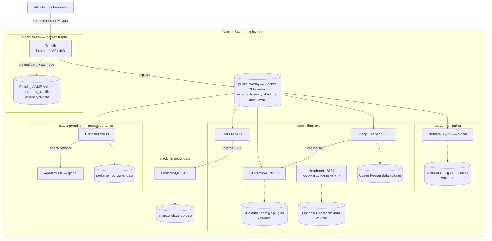

# LiteLLM X Server Config

Component-first Docker Swarm deployment and LiteLLM management configuration.

The repository exposes one CLI:

```bash
uv run llmproxy --help
```

## Quick start

```bash
cp .env.example .env
cp components/llmproxy/cli-proxy-api/configs/config.example.yaml \
  components/llmproxy/cli-proxy-api/configs/config.local.yaml
chmod 600 .env components/llmproxy/cli-proxy-api/configs/config.local.yaml

uv run llmproxy components
uv run llmproxy presets
uv run llmproxy inputs --preset default
uv run llmproxy validate --preset default
uv run llmproxy render --preset default
uv run llmproxy deploy --preset default --dry-run
```

`render`, `validate`, and `--dry-run` do not update the server. A deploy is a separate, explicit operation.

## Architecture

```text
components/<stack>/
├── compose.yaml                 # optional shared stack resources; no empty placeholder
├── stack.toml                   # optional stack ordering
└── <component>/
    ├── compose.yaml             # required component fragment
    ├── component.toml           # optional non-inferable metadata
    ├── integrations/<stack>/<component>/  # optional contributions to a destination
    ├── configs/                 # optional declarative inputs and adjacent schemas
    ├── overlays/<feature>.yaml  # optional feature overlays
    ├── compose.local.yaml       # optional ignored machine-local override
    ├── src/                     # optional backend logic, no CLI context/argparse
    ├── commands/*.py            # optional thin CLI adapters
    └── tests/                   # optional colocated tests

presets/<preset>.toml            # explicit component selection and inheritance
```

Generic filesystem discovery provides stack name, component name, Compose path, service names, overlays, commands, and local Compose overrides. LiteLLM's component-owned generator separately discovers its configuration contributions in selected components. `component.toml` is only an escape hatch for dependencies, required files/environment, and Docker config naming that must not be guessed.

There is no central component registry. Adding a simple component requires its `compose.yaml` and explicit selection by a preset. A newly discovered component is never added to production automatically.

Ownership includes libraries and data, not only CLI wrappers: LiteLLM owns its generator, sync backend, schemas, key rules, and tests under `components/llmproxy/litellm/`. `configs/` holds declarative inputs, whether runtime YAML or management config JSON, with schemas beside their JSON files. `src/` holds backend logic without `argparse` or CLI context; `commands/` only adapts CLI arguments/context to backend calls and CLI results. Create these optional directories only when they contain real files, never empty placeholders.

The generic `llmproxy/core/` provides shared CLI/context, environment, HTTP, resource, and component-loading utilities; `llmproxy/deployment/` handles generic deployment orchestration. Component libraries are loaded through `context.load_module(...)` or `llmproxy.core.component_modules.load_component_module(root, identifier, module_name)`. There are no global service-specific library packages or compatibility shims. Root `.env` and `presets/` remain shared. Retired paths are listed only as historical sources in [Migration](docs/migration.md).

See:

- [Architecture](docs/architecture.md)
- [Components](docs/components.md)
- [Component commands](docs/component-commands.md)
- [Presets](docs/presets.md)
- [Configuration](docs/configuration.md)
- [Deployment](docs/deployment.md)
- [Adding a component](docs/adding-a-component.md)
- [Migration](docs/migration.md)

## Server topology

The diagram describes the repository's desired logical topology with `default` **plus the separately selected** `portainer` and `traefik` presets. It is not a live-state inventory or a claim about node count. Headroom is optional (`all` / `llmproxy`), not part of `default`; live-only services such as Vault are outside this repository and are not shown.



Solid arrows show the main request paths; dotted arrows show persistent storage. Network membership is listed separately below to avoid implying that every service can reach every other service. The Headroom node, its volume, and its attachments apply only when that component is selected. Backend ports are overlay targets, not additional published host ports in this topology.

| Network (default physical name) | Created / owned by | Attached services in this topology |
|---|---|---|
| `public` | Docker CLI; no stack namespace label | Traefik, Portainer, LiteLLM, CPA, Usage Keeper, Netdata |
| `llmproxy` (`internal: true`) | `llmproxy-data` stack | PostgreSQL, LiteLLM, CPA, Usage Keeper, optional Headroom |
| `monitoring` | `monitoring` stack | Netdata; PostgreSQL, LiteLLM, CPA and optional Headroom through monitoring overlays |
| `portainer_agent-network` | `portainer` stack | Portainer and Agent |

- **Independent network:** create `public` with Docker CLI before deploying any consumer. Portainer and Traefik both use `external: true`; neither creates or owns it. For stack updates, reuse the existing network; deployment does not recreate or relabel it.
- **Persistent state:** preserve the existing ACME volume on `TRAEFIK_NODE_ID`. Portainer, PostgreSQL, CPA, Usage Keeper, Netdata, and optional Headroom retain their own declared volumes. Docker socket/host bind mounts and Docker config objects are omitted from the diagram for readability; their manifests remain authoritative.
- **Scope:** application/monitoring network names can be overridden through their declared environment variables. Usage Keeper is not attached to the monitoring network by this repository. The diagram does not change preset selection or publish extra ports.

## Presets

| Preset | Selection |
|---|---|
| `litellm-only` | PostgreSQL + LiteLLM, internal only |
| `litellm-traefik` | `litellm-only` + Traefik overlay |
| `litellm-standalone` | `litellm-only` + published port 4000 |
| `llmproxy` | PostgreSQL, LiteLLM, CLIProxyAPI, usage UI, Headroom + Traefik |
| `all` | Current full topology: `llmproxy` + Netdata + monitoring overlays |
| `default` | `all` minus the Headroom component and its LiteLLM guardrail |
| `portainer` | Portainer + Portainer Agent, no ingress service |
| `traefik` | Shared ingress using the independent external `public` overlay and existing ACME volume |

`portainer` and `traefik` are independent presets, not inherited by `all` or the LiteLLM presets. Select each explicitly. The `traefik` feature on application presets only adds routing labels; it does not deploy the ingress service.

Preset inheritance can subtract an inherited component with `exclude_components`. The
exclusion removes all resources owned by that component: Compose services, overlays,
local overrides, required inputs, Docker configs, and LiteLLM configuration layers.
For example, `default` extends `all` and excludes `llmproxy/headroom`. This is
component subtraction, not arbitrary service filtering: a one-service component naturally
omits that service, while excluding a multi-service component omits all of its services.

Inspect the resolved topology before deployment:

```bash
uv run llmproxy components
uv run llmproxy presets
uv run llmproxy inputs --preset default
uv run llmproxy validate --preset default
```

## Deployment

Render all stacks:

```bash
uv run llmproxy render --preset default
```

Render public definitions without ignored local overlays:

```bash
uv run llmproxy render --preset default --no-local-overrides
```

Dry-run one stack while retaining the full preset selection:

```bash
uv run llmproxy deploy \
  --preset default \
  --stack llmproxy \
  --driver ptctools \
  --allow-remove-services \
  --dry-run
```

Deploy with Docker:

```bash
uv run llmproxy deploy --preset default --driver docker
```

Inspect the independently selected Portainer stack without changing live state:

```bash
uv run llmproxy validate --preset portainer
uv run llmproxy render --preset portainer --no-local-overrides
uv run llmproxy deploy --preset portainer --driver docker --dry-run
uv run llmproxy render --preset traefik --no-local-overrides
uv run llmproxy deploy --preset traefik --driver docker --dry-run
```

Deploying a smaller preset under an existing stack name can remove services when `--allow-remove-services` enables Docker `--prune`. `ptctools` requires this acknowledgement because it cannot perform the same remote service-inventory preflight.

Content-addressed Docker config names remain stable when file content is unchanged. Existing Portainer configs are inspected and reused instead of being recreated.

## LiteLLM configuration

Config commands are owned by the `litellm` component in the `llmproxy` stack (`llmproxy/litellm`). The canonical form is `llmproxy <stack>/<component> <command> ...`: the full identifier avoids collisions between components with the same name in different stacks. The retired `component` prefix and former root `config` namespace have no compatibility aliases; see [Migration](docs/migration.md#component-ownership-and-cli-migration).

The shared base is:

```text
components/llmproxy/litellm/configs/config.json
```

Selected source components contribute through the explicit destination namespace `llmproxy/litellm`:

```text
components/<stack>/<component>/integrations/llmproxy/litellm/config.json
components/<stack>/<component>/integrations/llmproxy/litellm/config.local.json
```

The source owns the contribution, while LiteLLM owns its schema and interpretation. No mapping is duplicated in `component.toml`. Merge order remains base → all selected public contributions → all selected local contributions; local files are ignored by Git and omitted from packages.

Generate resolved configuration:

```bash
uv run llmproxy llmproxy/litellm config generate --preset default
```

The schema is `components/llmproxy/litellm/configs/config.schema.json`; the runtime YAML remains `components/llmproxy/litellm/configs/litellm.yaml`. The generator and sync backend live in the same component's `src/config_generate.py` and `src/config_sync.py`, loaded as `src.config_generate` and `src.config_sync`.

The default output is the ignored `build/llmproxy/litellm/config.gen.json`, written with mode `0600`.

Synchronize selected sections:

```bash
uv run llmproxy llmproxy/litellm config sync --preset default --dry-run
uv run llmproxy llmproxy/litellm config sync --preset default --only aliases,fallbacks
```

Config sync `--dry-run` validates configuration resolution only: it does not read live LiteLLM inventory, compute a live diff, or preview a prune plan. Resolution may still query providers for model discovery; it is not an offline guarantee.

Sync failures are fail-closed: invalid sections, missing files, API failures, and partial operation failures return non-zero.

## LiteLLM keys

Key CLI adapters are owned by `components/llmproxy/litellm/commands/` and discovered dynamically. Backend logic lives in `src/key_create.py` and `src/key_limits.py` in the same component, loaded as `src.key_create` and `src.key_limits`. Both canonical and unique global aliases are available:

```bash
uv run llmproxy llmproxy/litellm create-key user@example.com
uv run llmproxy key create user@example.com

uv run llmproxy llmproxy/litellm key-limits --dry-run
uv run llmproxy key limits --apply
```

Defaults for existing keys are 100 RPM, budget 700, and duration `7d`. Shared rules are in `components/llmproxy/litellm/configs/key-limits.json`, with schema in the sibling `key-limits.schema.json`; ignored private overrides are in `components/llmproxy/litellm/configs/key-limits.local.json`.

User lookup failures stop key creation. Only an explicit not-found response permits user creation.

## Local and secret files

The repository uses one operator-facing `.env`. Local files use the `*.local.*` convention and are ignored:

- `.env`
- `components/llmproxy/cli-proxy-api/configs/config.local.yaml`
- `components/*/*/compose.local.yaml`
- `components/*/*/integrations/llmproxy/litellm/config.local.json`
- `components/llmproxy/litellm/configs/key-limits.local.json`

Keep them mode `0600`. Public examples and schemas remain tracked.

`compose.local.example.yaml` is an explicit public exception: Git and packages retain it, but rendering never loads it automatically. Copy it to `compose.local.yaml` in the same component directory to activate a private override. Other `*.local*` files and private directories remain excluded.

The same root `.env` owns `PORTAINER_HOST` for the `portainer` preset, and `CF_DNS_API_TOKEN`, `LETSENCRYPT_EMAIL`, and `TRAEFIK_NODE_ID` for the `traefik` preset. Set `TRAEFIK_NODE_ID` to the node holding the existing `portainer_traefik-letsencrypt-data` volume. Traefik reuses that volume. All stacks, including Portainer and Traefik, consume `public` as an external overlay. Create the network separately with Docker CLI before deploying any consumer; no stack owns or creates it. See [Deployment](docs/deployment.md) for bootstrap prerequisites and stack updates; existing shared networks are reused, not recreated. Before deployment, the operator must verify that the selected node already holds the intended ACME data: Swarm can create an empty local volume if it is missing there, even with an external declaration. See [Deployment](docs/deployment.md) for bootstrap and the `/opt/portainer` / `/opt/traefix` operator layout.

## Installed wheel

Public resource roots are only `components/` and `presets/`, packaged automatically by convention alongside the generic Python package. Stack files, component commands, libraries, schemas, and public data travel with their owning component. Local/private files are excluded. Outside a checkout, the CLI uses packaged public resources. Set `LLMPROXY_ROOT=/path/to/checkout` when an installed CLI must use operator-local resources from a repository checkout.

## Verification

```bash
taskset -c 0,1 uv run --with 'hatchling>=1.27,<2' --with editables python3 -m unittest discover -s tests -p 'test_*.py'
taskset -c 0,1 uv build
```

The normal root discovery command includes colocated component tests through `tests/test_components.py`; LiteLLM tests live under `components/llmproxy/litellm/tests/`. The `--with` packages are ephemeral dependencies for packaging/editable-install tests, not new runtime dependencies.

No live deploy or live config sync is part of the test suite.
